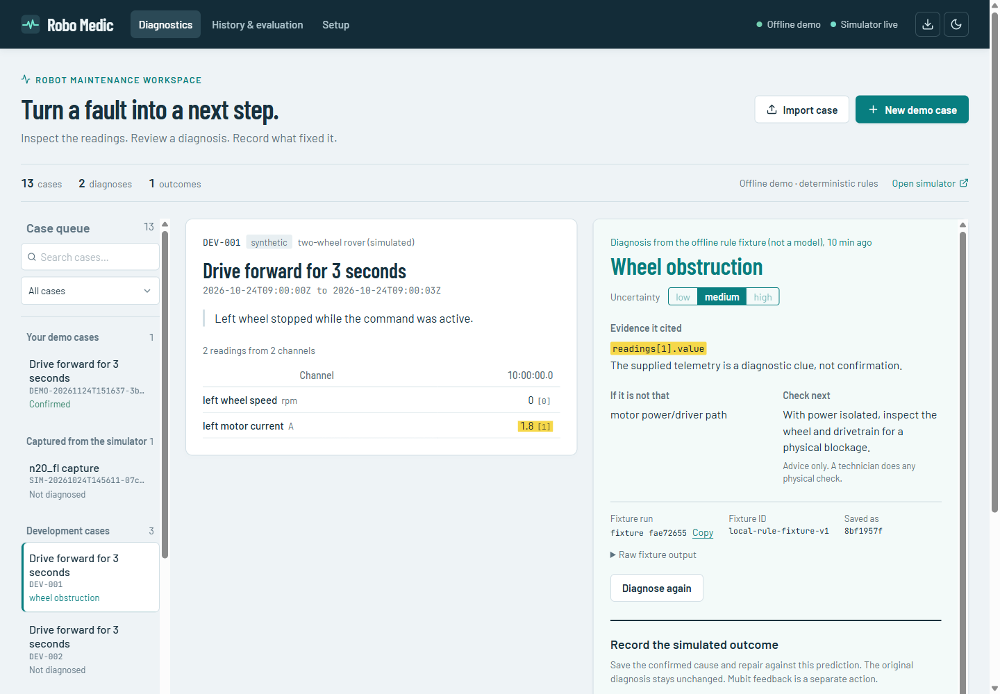

# Robo Medic

**Turn a robot fault into a useful next step.**

[](https://github.com/Codeedup/mubit-hackathon/actions/workflows/ci.yml)

A local workspace for robot fault diagnosis. Inspect telemetry, review an
evidence-linked recommendation, and record the cause and repair a technician
confirmed. Run the complete demo offline, or route classification through Mubit
with your own Gemini provider connection.



## Features

- Fresh synthetic cases, live four-motor simulator capture, and immutable JSON import.
- Offline rule engine or Gemini classification through Mubit, with cited readings,
  alternatives, uncertainty, and a next inspection step.
- Saved prediction snapshots, attributed outcomes, searchable cases, and exact-run history.
- Separate synthetic and physical evaluation, plus workspace JSON export.
- Optional live Mubit task/version status and explicit reviewed correction submission.
- Responsive desktop/mobile interface, light/dark themes, local fonts, and CI checks.

The diagnosis is advisory and sends no robot or simulator control commands. All
bundled and generated demo cases are labelled **synthetic**. The offline engine
is a rule fixture, not an LLM or an adapter.

## Quick start

Requires **Python 3.12+** and **Node.js 22+**. From the repository root:

Windows PowerShell:

```powershell
python -m venv .venv
.\.venv\Scripts\python.exe -m pip install -r backend/requirements.txt
npm --prefix frontend ci
npm --prefix frontend run build
.\.venv\Scripts\python.exe run.py --open
```

macOS / Linux:

```bash
python3 -m venv .venv
.venv/bin/python -m pip install -r backend/requirements.txt
npm --prefix frontend ci
npm --prefix frontend run build
.venv/bin/python run.py --open
```

Open **http://127.0.0.1:8000**. The launcher serves the built UI and API together
and starts the simulator at **http://127.0.0.1:8001**. No `.env` or API key is
needed for the offline demo. Dependencies and fonts are local after installation.

Use `--port 8010 --simulator-port 8011` if the defaults are occupied, or
`--no-simulator` for stored/generated cases only. The launcher checks ports,
binds to loopback, and stops its simulator server when you stop the app.

## Try it

1. Select **New demo case → Stopped wheel**.
2. Inspect zero wheel speed and high motor current, then **Run offline diagnosis**.
3. Follow the evidence link and review the next check.
4. Record an accurately described **simulated** outcome with your name.
5. Open **History & evaluation**, reload, and reopen the exact saved run.
6. Export the workspace with the download button in the header.

Try **Missing evidence** to see an unknown cause with high uncertainty.
See the [two-minute demo](docs/DEMO.md).

## Connect Mubit

Copy `.env.example` to `.env`. Add a Gemini provider key **in Mubit**, create a
project inference key, and configure:

```dotenv
ROBO_MEDIC_PROVIDER=mubit
MUBIT_API_KEY=<your Mubit inference key>
MUBIT_MODEL=gemini-3.8-flash
MUBIT_BASE_URL=https://api.mubit.ai/gemini
```

Restart the app. **Diagnose through Mubit** makes one inference request per
deliberate click. Errors stay visible; there is no silent provider switch or
automatic retry of uncertain requests. Keys stay server-side.

Optional `MUBIT_MANAGEMENT_KEY`, `MUBIT_PROJECT_ID`, and `MUBIT_TASK_ID` enable
task status and reviewed corrections. See [Mubit setup](docs/MUBIT.md).

**Observed on 24 November 2026:** the original task had 31 kept examples and
was waiting for 43, with no adapter ready. The Connect page reported no provider
key. This release was tested offline; live inference, management feedback, and
adapter performance were not verified against that account. The
[dated console record](docs/evidence/mubit-task-status-2026-11-24.txt) records that state.

## Data and API

Incidents are in `data/incidents/`; SQLite defaults to `backend/robo_medic.sqlite3`.
Paths can be overridden in `.env`. Existing case IDs cannot be overwritten;
use a new ID for a revision. Export is an evidence record, not a database restore
format. Back up the stopped database and incident directory for full recovery.

The API reference is at **http://127.0.0.1:8000/docs**, with health at
`/api/health`. `/api/setup` never includes credentials. Use one backend process
and database per workspace. This is a single-operator local app without authentication.

## Project guide

| Path | Purpose |
| --- | --- |
| `backend/` | FastAPI, provider integration, evidence rules, SQLite, evaluation, focused tests |
| `frontend/` | React/TypeScript app and desktop/mobile Playwright checks |
| `simulator/` | Virtual N20 motors, servo, telemetry, and fault injection |
| `data/` | Synthetic cases and separate answer keys |
| `docs/` | [Architecture](docs/ARCHITECTURE.md), [development](docs/DEVELOPMENT.md), evidence, and archives |
| `robo-medic-video/` | Editable historical hackathon video; separate from app startup |

Originally built by a three-person team for the 42-hour Mubit Night Shift
Hackathon. [October records](docs/archive/) preserve the event's observations.
No physical-board intake or measured adapter improvement is included.
See [release notes](CHANGELOG.md) and [contributing](CONTRIBUTING.md).
