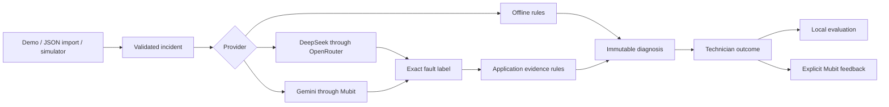

# Architecture

## Inputs

Version 1.0 incidents contain an ID, robot type, time window, commanded action,
readings, fault codes, technician note, and source type. Each reading has a
sensor, finite/nonblank value, unit, origin, and timezone-aware timestamp.
Synthetic and physical source labels cannot be mixed.

Imports are limited to 2 MB and 2,000 readings. IDs cannot contain paths. Complete
files become visible atomically; existing IDs cannot be replaced. Invalid stored
files cause a visible error rather than silently removing cases.

The simulator monitor polls every 0.5 seconds, waits for fresh fault packets,
and records two samples. Injected labels are saved separately. Neither provider
receives those labels or synthetic fault codes. The diagnosis path only reads
simulator state and never sends control commands.

## Diagnosis

The Mubit and OpenRouter routes send stable instructions and a label-free case description.
It accepts exactly `wheel obstruction`, `motor power/driver path`,
`encoder/reporting fault`, or `unknown`. Application rules then select supporting
readings, an alternative, next check, and uncertainty. A valid model label with
no supporting clue becomes `unknown`; the raw label is preserved. Unsupported
or malformed replies fail visibly. Uncertainty is rule-assigned, not a calibrated
probability. The offline fixture is explicitly recorded as `local_fixture`.

DeepSeek uses an OpenAI-compatible chat request, either directly through OpenRouter
(`provider_kind=openrouter`) or through Mubit's compatibility endpoint (`provider_kind=mubit`).
The direct route saves OpenRouter's generation ID and is excluded from Mubit feedback.
It disables reasoning and limits output to 128 tokens. Mubit OpenRouter adapter
serving is not currently available; see [the route guide](OPENROUTER.md).

## Persistence and replay

SQLite retains incident snapshots, raw replies, provider/model IDs, request
references, and one attributed outcome per diagnosis. Predictions do not change
when an outcome differs. The browser sends a fresh request ID per deliberate
click. A successful replay returns the saved result; a pending/failed attempt
cannot spend another call under that ID. Older clients omitting the optional
request ID do not receive replay protection.

Startup adds missing columns/tables to older databases. Legacy diagnoses without
snapshots/provider traces require separate archival or a new database; the app
does not invent missing evidence.

## Evaluation and Mubit

Synthetic evaluation uses the first stored prediction per incident across
providers, before later corrections, and reports missing/excluded cases.
Physical inspection scoring excludes simulated outcomes and deduplicates cases
per provider/model. Neither score demonstrates adapter improvement.

Live task status is fetched only when requested in Setup. Explicit feedback
requires a saved Mubit diagnosis, an outcome, a taxonomy label, and a verified
console call link. The project, original input, and reply must match. The app
stores the external acknowledgement and never initiates training or promotion.
See [MUBIT.md](MUBIT.md).

## Runtime

`run.py` starts one loopback API process and an optional simulator server thread. FastAPI
serves Vite's built assets. Vite's API proxy is available for development.
Unrecognised Host headers and foreign-origin writes are rejected. There is no
authentication, multi-user isolation, hosted deployment, or physical control layer.
